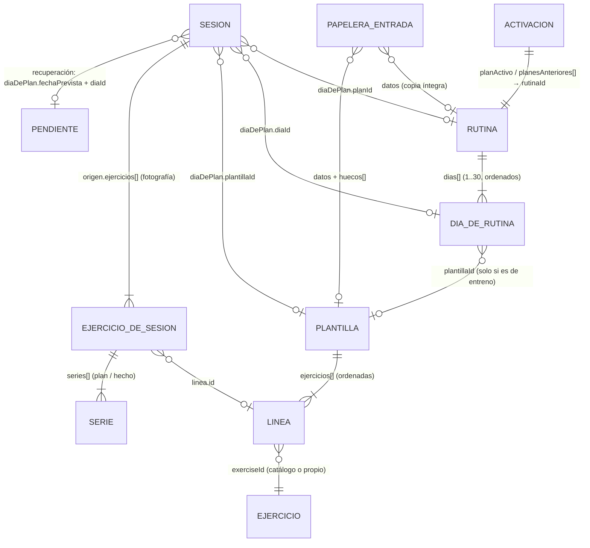

# FITNESS — ARQUITECTURA TÉCNICA (Fase 2/8)

> **Qué es.** El diseño técnico del rediseño de Fitness: entidades, modelo de datos, relaciones, ciclos,
> motor de cumplimiento y recuperación, estados, Eliminados recientemente, progresión, anotaciones,
> almacenamiento a largo plazo y migración. Lo pide el prompt 2 del plan
> (`docs/15_FITNESS/PLAN_DESARROLLO/PLAN_MAESTRO_FITNESS.md`) y lo leen las fases 3 a 8 antes de escribir
> código.
>
> **Qué no es.** No implementa nada. No cambia código, datos, SQL ni Supabase. Donde el diseño necesita
> SQL, el esquema se **documenta** y lo ejecutaría Josué si lo autoriza.
>
> **Base verificada:** `main` en `4881673` (v3.161.3), rama `claude/fitness-rediseno`, 2026-11-03. Cada
> afirmación sobre el código dice el archivo donde se comprobó. Se aplican las decisiones D-01 a D-05
> (Anexo E del plan) y las conclusiones de la Fase 1 (`docs/FITNESS_DOCUMENTO_MAESTRO.md`).
>
> **Convenciones.** «AT-nn» = decisión de arquitectura tomada en esta fase (técnica, dentro del encargo).
> «PD-nn» = decisión que necesita a Josué: se documenta con una **propuesta**, nunca se da por resuelta.
> Los nombres de campo nuevos son propuestas de la fase 2; la fase que los implemente puede ajustar el
> nombre, no el significado.

## Índice

1. Resumen de la arquitectura
2. Hallazgos del código que condicionan el diseño
3. Arquitectura conceptual: rutina, plantilla y sesión
4. Diagrama de entidades y relaciones
5. Modelo de datos (campo a campo)
6. Identificadores
7. Ciclos de rutina
8. Motor de cumplimiento y recuperación
9. Estados: de la sesión y de la fecha
10. Eliminados recientemente
11. Progresión
12. Anotaciones
13. Historial y escalabilidad
14. Migración y compatibilidad
15. Tabla comparativa: situación actual, arquitectura propuesta y cambios
16. Plan de implementación por fases
17. Decisiones pendientes
18. Riesgos residuales
19. Ajustes al implementar la Fase 3
20. Ajustes al implementar la Fase 4
21. Ajustes al implementar la Fase 5
22. Ajustes al implementar la Fase 6

---

## 1 · Resumen de la arquitectura

| Id | Decisión de arquitectura | Por qué |
|---|---|---|
| **AT-01** | **Se amplía lo que existe**: el objeto `fitness` de `app_data` sigue siendo la fuente de verdad durante las fases 3–7. Rutinas, plantillas y sesiones viven en él; nada se borra ni se renombra. | D-04; regla 5 del proyecto; sin SQL no hay otra opción que no exija a Josué. |
| **AT-02** | **Tres entidades separadas**: `rutinas` (nueva clave), `plantillas` (la de hoy, ampliada) y `sesiones` (la de hoy, ampliada). Los 17 planes son **rutinas predeterminadas** y sus 63 días de entreno, **plantillas predeterminadas**; los dos viven en el código. | Prompt 2 §3; D-05. |
| **AT-03** | **Lo predeterminado se copia al escribir** (*copy-on-write*): se lee del código; al editarlo o borrarlo se guarda una copia **con el mismo id** en `fitness`, que tiene prioridad sobre la del código. | Conserva ids (D-05) y permite editar, borrar y recuperar con la papelera general sin migrar 80 elementos de golpe. |
| **AT-04** | **Lo calculable no se guarda**: el día del ciclo, los pendientes, la caducidad, el estado de cada fecha, «en uso», las propuestas de progresión y la nota anterior se **derivan** en el momento con funciones puras. | Lección repetida del proyecto (F15, F22, F24, F28): sin copias no hay nada que invalidar. |
| **AT-05** | **La sesión guarda su vínculo con el plan**: rutina, día, plantilla, posición del ciclo, **fecha prevista** y **clase** (prevista, recuperación o libre). Se guarda en `diaDePlan`, que ya existe y que las versiones viejas de la aplicación conservan entero. | Prompt 4 §9; compatibilidad durante la transición (§2, H-03). |
| **AT-06** | **Identificadores estables e independientes** para rutina, día, plantilla y línea, también para lo predeterminado (escritos en el código y protegidos por una prueba). | Prompt 2 §4. Hoy las líneas de los planes cambian de id en cada carga (H-01). |
| **AT-07** | **Un motor de cumplimiento único y puro** (`cumplimientoFitness.js`, capa «motores»): calendario previsto → clasificación de sesiones → pendientes y caducidad (D-02) → estado de cada fecha → opciones de recuperación y sus consecuencias. Pantalla, calendario e historial lo leen; ninguno calcula. | Prompt 2 §6; prompt 4 §11–12. |
| **AT-08** | **Guardia de versión antes de cambiar el formato** (fase 3, primera entrega): una versión de la aplicación que encuentre datos de una versión más nueva **no guarda Fitness**. | Hoy una versión vieja abierta en otro dispositivo borraría los campos nuevos al guardar (H-02, H-04). |
| **AT-09** | **Migración v1 → v2 aditiva e idempotente**, con copia de seguridad en otra clave de `app_data` antes de escribir. No reescribe ninguna sesión ni ningún id; añade claves, ancla los ciclos y fija la fecha desde la que se evalúa el cumplimiento. | Prompt 2 §12. |
| **AT-10** | **Una sesión por fecha**: garantía en el cliente desde la fase 4; garantía de servidor **diseñada** (tabla de reserva de fechas, §13) y pendiente del SQL de Josué (PD-03). No se afirmará una garantía de servidor que no exista. | Prompt 2 §11; prompt 4 §12. |
| **AT-11** | **Eliminados recientemente = la papelera general** (`src/lib/papelera.js`), con una «puerta» propia de Fitness en `App.jsx` (como las de Imagen personal) que guarda en la entrada los huecos que dejó una plantilla en las rutinas. | Prompt 2 §8; D-05. |

---

## 2 · Hallazgos del código que condicionan el diseño

Todos comprobados en `main` `4881673`.

| Id | Hallazgo | Dónde | Consecuencia para el diseño |
|---|---|---|---|
| **H-01** | Las **líneas de ejercicio de los planes predeterminados** reciben `uid()` en cada carga: `crearDiaDePlan` → `crearLinea`, que siempre pone `id: uid()`. Los **días** sí son estables (`ppl-estetico-dia-1`, FIT F32). | `planes.js:155`, `constructor.js:160` | La progresión y las notas por línea necesitan ids de línea **escritos en el catálogo** (AT-06). |
| **H-02** | La carga **reconstruye cada sesión campo a campo** (`crearWorkoutSession`, `crearSerie`, `crearEjercicioDeSesion`): un campo que no conozca se **pierde** en el siguiente guardado. En cambio, en el nivel superior de `fitness` las claves desconocidas **se conservan** (`...g` en `normalizarFitness`). | `fitness.js:549`, `:972`; `entrenamiento.js:143`, `:198`, `:980` | Una versión vieja de la aplicación (otra pestaña, otro dispositivo) **borraría** los campos nuevos de las sesiones (AT-08). Las claves nuevas de primer nivel sobreviven. |
| **H-03** | Hay **objetos que se conservan enteros** al cargar: `sesion.diaDePlan`, `sesion.media`, `ejercicioDeSesion.linea`, `lineaDePlantilla.config` y `plantilla.meta`. `sesion.origen` **no**: se rehace con `tipo`, `id` y `ejercicios`. | `fitness.js:608`, `entrenamiento.js:216`, `fitness.js:454`, `:488`; `entrenamiento.js:986` | Los datos nuevos que tienen su sitio natural en esos objetos (vínculo con el plan, id de línea, configuración de progresión) **sobreviven** incluso a una versión vieja (AT-05). |
| **H-04** | `migrarFitness` deja tal cual una versión **mayor** que la del código (`futura: true`)… pero la aplicación **sigue guardando** después: no hay nada que la detenga. Y `normalizarFitness` conserva el número de versión, así que tras el guardado los datos dirían «v2» sin sus campos. | `persistenciaFitness.js:150`; `App.jsx:900`, `:1212` | Necesaria la guardia de versión (AT-08) **una entrega antes** de escribir la v2. |
| **H-05** | `fitness.planes` existe, está vacía y **sin escritor** (`SIN_ESCRITOR`), pero su normalizador le aplica la forma de una plantilla (`normalizarWorkoutPlan`), que **no tiene `dias`**. | `planes.js:804`; `fitness.js:976` | Las rutinas **no** pueden guardarse en `planes`: una versión vieja les quitaría los días. Van a una **clave nueva**, `rutinas` (H-02: sobrevive). `planes` se queda como está. |
| **H-06** | `planActivo` se reconstruye con tres campos (`planId`, `origen`, `desde`); `planesAnteriores` guarda tramos cerrados con la **estructura** de sus días (`id`, `nombre`, `descanso`), pero **sin la plantilla** de cada día. | `fitness.js:930`, `:947`; `planes.js:536`, `:561` | El mecanismo de tramos **se reutiliza** para no reescribir el pasado al editar o cambiar de rutina, ampliado con `plantillaId` e `inicioCiclo` por día y tramo. |
| **H-07** | Hoy el día del plan de 7 días es **el día de la semana** (lunes = día 1); el resto **cicla desde `desde`**. | `tuPlan.js:203` | La migración ancla el ciclo de los planes activos de 7 días **al lunes** para que ningún día cambie de nombre (§7.6). |
| **H-08** | La sesión guarda `diaDePlan = { planId, tipo, diaId, nombre }` al guardar, y `origen.id` es el **id del día** en los predeterminados y el **id de la plantilla** en las propias. | `finalizacion.js:338`; `entrenamiento.js:251` | Los papeles se separan en campos nuevos (`plantillaId`, `diaId`); lo guardado conserva su forma y se interpreta con una regla de compatibilidad (§14.6). |
| **H-09** | La serie guarda `plan` y `hecho` separados, y `estado` `pendiente` / `hecha` / `omitida`; la sesión es «vacía» si no hay ninguna `hecha`. Las repeticiones son **enteras en todas las capas** (`enteroONull`): 8,5 se guarda como 9. | `entrenamiento.js:117–170`, `finalizacion.js:267` | La separación plan/hecho ya existe y se conserva. Las medias repeticiones exigen otro validador **y** la guardia de versión: una versión vieja redondearía 8,5 al guardar. |
| **H-10** | La papelera general guarda el objeto **íntegro** y conserva cualquier campo extra de la entrada; `App.jsx` ya tiene «puertas» propias por módulo para eliminar y restaurar. Retención configurable (7, 30, 90 días o «hasta que yo lo borre»; 30 por defecto). | `papelera.js:33`, `:232`, `:292`; `App.jsx:1775` | Fitness reutiliza la papelera tal cual, con su puerta (AT-11). |
| **H-11** | `saveData` sube **el objeto entero** con `upsert` sobre `(user_id, key)`: gana la última escritura. Dos dispositivos que guarden a la vez se pisan **entero**, no por sesión. | `supabase.js:109`; `supabase/schema.sql` | Riesgo existente; la regla de una sesión por día no se puede garantizar en el servidor sin SQL (§13). |
| **H-12** | Los 17 planes tienen **7 días**; **63** días de entreno y **297** líneas; **ningún día repite** el contenido ni el nombre de otro del mismo plan; **ningún día ni línea trae id en el archivo fuente** (los ids de día se generan por posición). | `catalogoPlanes.js` (recuento con un script de lectura, sin escribir nada) | 63 plantillas predeterminadas, una por día de entreno, sin fusionar ninguna. |

---

## 3 · Arquitectura conceptual: rutina, plantilla y sesión

```
PLANIFICACIÓN                          EJECUCIÓN                    HISTORIAL Y CUMPLIMIENTO
─────────────                          ─────────                    ────────────────────────
Rutina (1–30 días, cíclica)            Sesión                       Motor de cumplimiento
  └─ Día 1..N ── entreno → Plantilla      ├─ vínculo: rutina, día,     (derivado, no se guarda)
               └ descanso                 │  plantilla, fecha prevista,  ├─ calendario previsto
Plantilla (lista de líneas)               │  clase                       ├─ pendientes y caducidad
  └─ Línea: ejercicio, series,            ├─ fotografía de la plantilla  ├─ estado de cada fecha
     objetivos, progresión, nota          │  (líneas → series plan/hecho)└─ opciones de recuperación
                                          └─ notas por ejercicio
Rutina activa + tramos anteriores ────────────────────────────────────────▶ (qué tocaba cada fecha)
```

- **Rutina**: qué toca cada día del ciclo. Solo referencia plantillas por id; no contiene ejercicios.
- **Plantilla**: qué se hace en un entrenamiento. No sabe en qué rutinas está («en uso» se deriva).
- **Sesión**: qué se hizo una fecha concreta. Lleva una **fotografía inmutable** de la plantilla al empezar
  (`origen.ejercicios`, ya existe desde FIT F7) y **no depende** de que la rutina o la plantilla sigan
  existiendo: guarda sus ids para relacionarla, y su fotografía para leerla.

---

## 4 · Diagrama de entidades y relaciones



Relaciones, en palabras:

| Relación | Cardinalidad | Cómo se guarda | Qué pasa si el destino desaparece |
|---|---|---|---|
| Rutina → días | 1 a 1..30, ordenados | `rutina.dias[]` | — |
| Día → plantilla | 0..1 (solo días de entreno) | `dia.plantillaId` | Al borrar la plantilla: si la rutina es la activa, el día pasa a descanso (§10.2); si no, el día queda «sin plantilla» y la rutina no se puede activar hasta reasignarlo. |
| Plantilla → líneas | 1 a 1..n, ordenadas | `plantilla.ejercicios[]` (ya existe) | — |
| Línea → ejercicio | n a 1 | `linea.exerciseId` (ya existe) | Ejercicio archivado: se sigue leyendo por id (FIT F35). |
| Activación → rutina | 1 a 1 | `planActivo.planId` (+ tramos en `planesAnteriores`) | Rutina borrada siendo activa: se pide confirmación y se desactiva (§10.3). |
| Sesión → rutina, día, plantilla | n a 0..1 cada uno | ids en `sesion.diaDePlan` | Nada: la sesión conserva su fotografía y sus ids; la pantalla dice «plantilla eliminada». |
| Ejercicio de sesión → línea | n a 0..1 | `linea.id` en la fotografía | Nada: la nota y los resultados siguen en la sesión. |
| Recuperación → pendiente | 1 a 1 | `diaDePlan.fechaPrevista` + `diaId` + `planId` en la sesión que recupera | El pendiente **no se guarda**: es la terna (rutina, día, fecha prevista) y se reconoce por ella. |
| Plantilla → rutinas que la usan | derivada | — (se calcula recorriendo `rutinas`) | Siempre al día. |

---

## 5 · Modelo de datos (campo a campo)

Columnas: **Tipo** · **Ob.** (obligatorio) · **Función** · **Validación** · **Relación**. «Nuevo» marca los
campos que no existen hoy. Los que existen conservan su nombre y su forma.

### 5.1 `fitness` (nivel superior)

| Campo | Tipo | Ob. | Función | Validación | Relación |
|---|---|---|---|---|---|
| `version` | entero | sí | Versión del formato. Pasa de **1 a 2** con la migración (§14). | entero ≥ 1; mayor que la del código → solo lectura (AT-08) | — |
| `rutinas` *(nuevo)* | lista de Rutina | sí (vacía) | Rutinas propias y **copias** de las predeterminadas que él ha editado (AT-03). | ids únicos; cada una válida (§5.2) | ← `planActivo`, `planesAnteriores`, `sesion.diaDePlan` |
| `plantillas` | lista de Plantilla | sí | Plantillas propias (hoy) y copias editadas de las predeterminadas. | ids únicos | ← `dia.plantillaId`, `sesion.diaDePlan.plantillaId` |
| `predeterminadasRetiradas` *(nuevo)* | `{ rutinas: id[], plantillas: id[] }` | sí (vacías) | Predeterminadas que él borró y cuya entrada de la papelera ya caducó: no se vuelven a enseñar. | ids de predeterminadas existentes | → catálogo del código |
| `planActivo` | Activación \| `null` | — | La rutina activa (§5.5). | — | → rutina |
| `planesAnteriores` | lista de Tramo | sí | Lo que estuvo activo antes y **cada versión anterior de la activa** (§7.5). | §5.5 | → rutina |
| `sesiones` | lista de Sesión | sí | Las ejecuciones (§5.6). | ids únicos; una por fecha (§8.8) | → rutina, día, plantilla |
| `cumplimientoDesde` *(nuevo)* | fecha ISO \| `''` | sí | Desde qué fecha el motor evalúa el cumplimiento. Antes: historial sin colores de cumplimiento (PD-09). | fecha válida o vacía | — |
| `preferencias` *(nuevo)* | `{ progresion: 'manual' \| 'progresivo' \| 'experto' }` | sí | El modo de progresión (§11). Por defecto `'manual'`: no cambia nada a quien no lo toque. | uno de los tres | — |
| `planes`, `ejercicios`, `rangos`, `favoritosPlanes`, `favoritosEjercicios`, `objetivos`, `clasificaciones`, `cuarentena` | (como hoy) | — | Sin cambios. `favoritosPlanes` pasa a significar «rutinas favoritas» (mismos ids). | (como hoy) | — |

### 5.2 Rutina *(nueva entidad guardada; las predeterminadas viven en el código)*

| Campo | Tipo | Ob. | Función | Validación | Relación |
|---|---|---|---|---|---|
| `id` | texto | sí | Identidad estable (§6). | no vacío, único entre rutinas propias y predeterminadas | ← activación, tramos, sesiones |
| `nombre` | texto | sí | Lo que ve. | 1–60 caracteres tras recortar | — |
| `descripcion` | texto | no | Nota libre. | ≤ 500 | — |
| `origen` | `'propia'` \| `'predeterminada'` | sí | Si es suya o es la copia de una predeterminada (mismo id que la del código). | uno de los dos | — |
| `basePredeterminada` | texto \| `null` | no | Si se **duplicó** desde una predeterminada, su id (solo informativo, «viene de…»). | id existente o `null` | → catálogo |
| `dias` | lista de Día (§5.3) | sí | El ciclo, en orden. Su longitud **es** la duración. | 1 ≤ longitud ≤ 30; todos configurados para guardar | → plantillas |
| `meta` | objeto | no | Metadatos de presentación (entorno, objetivo, dificultad, etiquetas), con la forma que ya tienen los planes. | objeto | — |
| `creadoEn`, `editadoEn` | fecha ISO | sí | Como las plantillas (FIT F4). | fecha válida | — |

No se guarda `duracion` (sería una copia de `dias.length`) ni «en uso» ni «activa».

### 5.3 Día de rutina

| Campo | Tipo | Ob. | Función | Validación | Relación |
|---|---|---|---|---|---|
| `id` | texto | sí | Identidad del día **dentro del ciclo**, independiente de su posición y de la plantilla (§6). Reordenar no lo cambia. | único dentro de la rutina | ← sesiones (`diaDePlan.diaId`), tramos |
| `tipo` | `'entreno'` \| `'descanso'` \| `null` | sí | Qué es ese día. `null` solo mientras se edita: **no se puede guardar** (prompt 3 §4). | para guardar, nunca `null` | — |
| `plantillaId` | texto \| `null` | si `tipo='entreno'` | La plantilla de ese día. Una plantilla puede estar en varios días. | existe en la biblioteca al guardar | → plantilla |

Lo guardado de los planes (`descanso: true/false`) se lee como `tipo` (compatibilidad, §14.6). El nombre del
día **no se guarda**: es el de su plantilla (o «Descanso»), y así renombrar la plantilla lo renombra en
todas las rutinas.

### 5.4 Plantilla y línea *(ampliación de `crearWorkoutPlan` / `crearWorkoutExercise`, `fitness.js`)*

Plantilla: se conservan todos sus campos (`id`, `nombre`, `descripcion`, `entorno`, `frecuencia`,
`duracion`, `thumbnail`, `ejercicios`, `meta`, `creadoEn`, `editadoEn`). Novedades:

| Campo | Tipo | Ob. | Función | Validación | Relación |
|---|---|---|---|---|---|
| `meta.origen` *(nuevo, dentro de `meta`)* | `'propia'` \| `'predeterminada'` | sí | Si es la copia de una predeterminada (mismo id). Va en `meta` porque ese objeto se conserva entero (H-03). ⚠️ `duplicarPlantilla` copia `meta` entero (`plantillas.js:234`): al duplicar hay que poner `'propia'`, o la copia se haría pasar por predeterminada. | uno de los dos | → catálogo |
| `meta.origenPlan`, `meta.origenDia` | texto | no | **Ya existen** (los pone «Personalizar», `planes.js:649`). Solo informativos. | — | — |

Línea (`ejercicios[]`): se conservan `id`, `exerciseId`, `orden`, `series`, `repeticiones`, `repsHasta`,
`peso`, `descanso`, `notas`, `config`, `modo`, `duracion`, `tipoCarga`, `bloqueId`. Novedades:

| Campo | Tipo | Ob. | Función | Validación | Relación |
|---|---|---|---|---|---|
| `id` | texto | sí | **Ya existe** en las propias; en las predeterminadas pasa a estar **escrito en el catálogo** (H-01). Identidad para progresión y notas (§6). | único dentro de la plantilla; no cambia al reordenar ni al editar | ← `ejercicioDeSesion.linea.id` |
| `config.progresion` *(nuevo, dentro de `config`)* | booleano | no (`false`) | El interruptor «Progresión» de la línea (prompt 5 §4). En `config` porque se conserva entero (H-03). | booleano | — |
| `repeticiones`, `repsHasta` | número | no | Pasan a admitir **medias** (prompt 5 §8). | entero o x,5; nada más (§11.4) | — |
| `notas` | texto | no | **Ya existe**: indicación permanente de la plantilla (no es una anotación de ejecución, §12). | ≤ 500 | — |

### 5.5 Activación (`planActivo`) y tramo (`planesAnteriores[]`)

| Campo | Tipo | Ob. | Función | Validación | Relación |
|---|---|---|---|---|---|
| `planId` | texto | sí | Id de la rutina activa (nombre conservado por compatibilidad). | rutina existente (propia o predeterminada) | → rutina |
| `origen` | `'preset'` \| `'rutina'` \| `'plantilla'` | sí | Dónde buscarla: `'preset'` = predeterminada (sus ids no cambian), `'rutina'` = propia (nuevo), `'plantilla'` = lo de hoy (una plantilla usada como plan de un día). | uno de los tres | — |
| `desde` | fecha ISO | sí | Desde cuándo está activa. Ya existe. | fecha válida | — |
| `inicioCiclo` *(nuevo)* | fecha ISO | sí | La fecha que corresponde al **día 1** del ciclo (§7). | fecha válida, ≤ hoy | — |

Tramo (`planesAnteriores[]`): se conservan `planId`, `origen`, `desde`, `hasta`, `nombre` y `dias[]` (`id`,
`nombre`, `descanso`). Se añaden, **por tramo**, `inicioCiclo` y, **por día**, `plantillaId`. Así el
pasado se lee siempre con la estructura que tenía.

### 5.6 Sesión *(ampliación de `crearWorkoutSession`)*

Se conservan **todos** los campos actuales (`id`, `planId`, `nombre`, `fecha`, `inicio`, `fin`,
`ejercicios`, `notas`, `descripcion`, `estado`, `origen`, `iniciadaEn`, `terminadaEn`, `pausadaEn`,
`pausadoMs`, `actual`, `visibilidad`, `media`, `diaDePlan`, `guardadaEn`, `descanso`, `descansoAuto`,
`entorno`, `pesoCorporal`). Lo que cambia:

| Campo | Tipo | Ob. | Función | Validación | Relación |
|---|---|---|---|---|---|
| `fecha` | fecha ISO | sí | **Fecha real de ejecución** (ya lo es: el día en que empieza). Nunca se mueve para aparentar otro día (prompt 4 §9). | fecha válida, no futura | — |
| `diaDePlan` | objeto \| `null` | sí en sesiones nuevas | **El vínculo con el plan** (AT-05). Ya existe con `planId`, `tipo`, `diaId`, `nombre`; se amplía con los campos de abajo. Se escribe **al empezar** (hoy se escribe al guardar). | ver subcampos | → rutina, día, plantilla |
| `diaDePlan.plantillaId` *(nuevo)* | texto \| `null` | sí si hay plantilla | La plantilla ejecutada. Separa el papel que hoy hace `origen.id` (H-08). | id de plantilla | → plantilla |
| `diaDePlan.posicion` *(nuevo)* | entero \| `null` | no | Posición del día en el ciclo (0…N−1) en la fecha prevista. Informativo. | 0 ≤ p < 30 | — |
| `diaDePlan.fechaPrevista` *(nuevo)* | fecha ISO \| `null` | sí si `clase ≠ 'libre'` | La fecha en que **debía** hacerse. Igual a `fecha` en una prevista; anterior en una recuperación. | ≤ `fecha` | → pendiente |
| `diaDePlan.clase` *(nuevo)* | `'prevista'` \| `'recuperacion'` \| `'libre'` | sí en sesiones nuevas | Tipo de cumplimiento (prompt 4 §9). | uno de los tres | — |
| `completadaCon` *(nuevo)* | `'directo'` \| `'completar'` | sí en sesiones nuevas | Cómo se registró. `'completar'` = «Completar entrenamiento» (D-03). | uno de los dos | — |
| `conflicto` *(nuevo)* | `null` \| `{ con: id, desde: fecha }` | no | Marca una sesión que llegó por sincronización a una fecha que ya tenía otra (§8.8). Nunca se borra sola. | — | → otra sesión |

**Por qué el vínculo va en `diaDePlan` y no en campos nuevos de primer nivel de la sesión:** es
exactamente lo que ese objeto significa desde FIT F8 («qué día del plan se completó»), y es el único
objeto de la sesión que una versión vieja conserva entero (H-03). `completadaCon` y `conflicto` sí son
nuevos de primer nivel: dependen de la guardia de versión (AT-08).

**El identificador del pendiente recuperado** (prompt 4 §9) es la terna `diaDePlan.planId` +
`diaDePlan.diaId` + `diaDePlan.fechaPrevista`: identifica sin ambigüedad «el entrenamiento que tocaba
aquel día en aquella rutina». No se crea un id de pendiente porque los pendientes no se guardan (AT-04).

### 5.7 Ejercicio de sesión y serie *(fotografía; `entrenamiento.js`)*

Se conservan todos sus campos. Cambios:

| Campo | Tipo | Ob. | Función | Validación | Relación |
|---|---|---|---|---|---|
| `linea.id` *(nuevo, dentro de `linea`)* | texto \| `null` | sí en sesiones nuevas | Id de la línea de la plantilla de la que salió. `linea` ya se conserva entero (H-03). Un ejercicio **añadido** durante la sesión lleva `null`. | — | → línea |
| `linea.progresion` *(nuevo)* | booleano | no | Copia **de ese día** del interruptor de la línea: es parte de la fotografía (lo que estaba configurado al entrenar). | booleano | — |
| `notas` | texto | no | **Ya existe**: la anotación de ese ejercicio en esa ejecución (§12). | ≤ 1000 | — |
| `series[].plan.reps`, `hecho.reps`, `plan.repsHasta` | número | no | Pasan a admitir medias (§11.4). | entero o x,5 | — |
| `series[].plan.propuesta` *(nuevo)* | `{ reps?, peso?, duracion? }` \| `null` | no | Lo que **propuso** la progresión al empezar (prompt 5 §9). Separado de `plan` (lo que decía la plantilla) y de `hecho` (lo que hizo). | mismas reglas | — |

**«Completar entrenamiento» (D-03) en este modelo:** crea la sesión con la fotografía de la plantilla
(todas sus líneas y series) y marca **todas las series** `estado: 'hecha'` con `hecho` **vacío**, y
`completadaCon: 'completar'`. Resultado: la sesión es **completa** (todas las series hechas), no inventa
ningún valor, y la progresión la ignora porque no hay valores que comparar (`hecho` vacío no es
comparable en `progresion.js`). Es distinto de la PR #2, que guardaba la sesión **sin series** (§14.7).

---

## 6 · Identificadores

| Entidad | Propias | Predeterminadas | Reglas |
|---|---|---|---|
| Rutina | `uid()` | **el id actual del plan** (`ppl-estetico`) | Nunca cambia. Duplicar crea uno nuevo. |
| Día de rutina | `uid()` | **el id actual del día** (`ppl-estetico-dia-1`) | Único en su rutina; reordenar no lo cambia; **distinto** del de la plantilla. |
| Plantilla | `uid()` (hoy) | **`<id del día>-plantilla`** (p. ej. `ppl-estetico-dia-1-plantilla`) | Un id por concepto: el día y su plantilla nunca comparten id (prompt 2 §4). |
| Línea | `uid()` (hoy) | **`<id de la plantilla>-l<n>`**, escrito una vez en `catalogoPlanes.js` | Se escribe en el archivo fuente en la fase 3 y **no se renumera nunca**: un ejercicio nuevo recibe el siguiente número libre. Una prueba compara la lista de ids con una instantánea. |

Reglas comunes: los ids son **texto opaco** (nadie deduce nada de su forma salvo la regla de
compatibilidad del §14.6); se validan únicos en cada lista; duplicar una plantilla da **ids nuevos** a la
plantilla y a sus líneas (ya lo hace `duplicarPlantilla`, FIT F4), así que la copia empieza su propio
historial (§11.3); la copia *copy-on-write* de una predeterminada **conserva** su id y los de sus líneas.

---

## 7 · Ciclos de rutina

### 7.1 Datos

- **Duración** `N = rutina.dias.length` (1 ≤ N ≤ 30).
- **Inicio del ciclo** `inicioCiclo`: la fecha que es el día 1 (en la activación y en cada tramo).

### 7.2 Cálculo

Para una fecha `f` cubierta por un tramo (activo o anterior) con su rutina y su `inicioCiclo`:

```
d        = díasEntre(inicioCiclo, f)          // en fechas locales, nunca en UTC (helpers.js)
si d < 0 → «antes de la activación»: sin día (nunca se proyecta hacia atrás)
posicion = d mod N                            // 0 … N−1
día      = rutina.dias[posicion]
ciclo    = floor(d / N) + 1                   // número de vuelta, informativo
```

Es una función pura de (fecha, estructura, inicioCiclo): **no depende de abrir o cerrar la aplicación**
(prompt 3 §6) y el reinicio al terminar el último día sale del módulo, sin guardar nada.

### 7.3 Activar una rutina

Por defecto `inicioCiclo = desde = hoy` (hoy es el día 1). La pantalla puede ofrecer **empezar por otro
día** del ciclo: entonces `inicioCiclo = hoy − (k − 1)` para empezar por el día `k`. Activar una rutina
**cierra el tramo** de la anterior en `planesAnteriores` (lo que ya hace `usarPlan`), con su estructura
completa.

### 7.4 Cambiar de rutina

Como hoy: tramo cerrado, nueva activación, nada del pasado cambia. Las sesiones no se reasignan. Los
pendientes de la rutina anterior quedan **bloqueados** mientras esté activa otra (regla 9) y siguen
sumando entrenamientos posteriores para su caducidad (§8.4).

### 7.5 Editar la rutina activa (duración, orden o asignaciones)

Para no reescribir el pasado (prompt 2 §5):

1. Se **cierra un tramo** con la estructura anterior (`dias` con `plantillaId`) y su `inicioCiclo`,
   `hasta = hoy`. Es el mismo mecanismo de `conElTramoCerrado`, que hoy solo se usa al cambiar de plan.
2. Se abre la estructura nueva desde hoy con un `inicioCiclo` que **conserva el día de hoy por su id**:
   si el día que tocaba hoy sigue existiendo en la posición `k'`, `inicioCiclo = hoy − k'`. Si se ha
   borrado, hoy pasa a ser el día 1 (`inicioCiclo = hoy`). La pantalla lo dice antes de guardar.
3. Los días ya pasados se siguen leyendo con el tramo cerrado: un pendiente conserva su rutina, su día y
   su plantilla de entonces (prompt 4 §5.4).
4. Si la edición es el mismo día de la activación, se sustituye la estructura sin crear un tramo de
   cero días (como ya hace `conElTramoCerrado`).

Editar una rutina **no activa** no crea tramos (no ha cubierto ninguna fecha desde la última vez).

### 7.6 Lo que ya existe (compatibilidad)

Los planes predeterminados activos (7 días) se leen hoy por **día de la semana** (H-07). La migración les
da `inicioCiclo = lunes de la semana de su desde` (o de la fecha de migración, si no tienen `desde`). Como
`(fecha − un lunes) mod 7 = díaDeLaSemana − 1`, **ningún día cambia de posición**. Lo mismo para cada tramo
de 7 días de `planesAnteriores`. Una plantilla usada como plan (1 día) recibe `inicioCiclo = desde`.

---

## 8 · Motor de cumplimiento y recuperación

Un solo archivo de la capa «motores», `src/lib/cumplimientoFitness.js` (nombre propuesto; se buscará antes
de crearlo, como pide el proyecto). Funciones **puras**: reciben `fitness` y `hoy`, no leen el reloj ni
guardan nada. Pantalla principal, calendario, historial, chatbot y estadísticas leen de él (prompt 4 §11).

### 8.1 Entradas y definiciones

- **Hoy**: la fecha local del dispositivo (`todayISO`); se recalcula al cambiar el día con la aplicación
  abierta (`useHoyISO`, hoy no lo usa Fitness).
- **Día terminado**: toda fecha `< hoy`. Hoy no está terminado hasta las 00:00 locales.
- **Previsto(f)**: lo que tocaba en `f` según el tramo que la cubre (§7): `{ planId, diaId, posicion,
  tipo: entreno|descanso, plantillaId }`; o `sin_rutina` si se sabe que no había ninguna; o `desconocido`.
- **Sesión que cuenta para el cumplimiento**: `estado = 'completada'` y `conflicto = null`. Una
  `descartada` no existe a efectos de cumplimiento.
- **Grado de una sesión** (derivado de su fotografía, §9.1): `completa`, `parcial` o `vacia`.
  `completadaCon = 'completar'` es siempre `completa`.
- **Entrenamiento realizado** (para la caducidad, D-02): sesión que cuenta y cuyo grado es `completa`;
  `vacia` **nunca** (caso 11); `parcial` y las sesiones `libre`: **según PD-01** (el motor lleva los dos
  casos como parámetros, `REALIZADO.parcial` y `REALIZADO.libre`, sin valor decidido).

### 8.2 Clasificación de las sesiones

Cada sesión nueva nace clasificada (se escribe al empezar, no se adivina después):

| Clase | Cuándo | `fechaPrevista` |
|---|---|---|
| `prevista` | Ejecuta la plantilla del día previsto **de su misma fecha** (rutina activa). | `= fecha` |
| `recuperacion` | Ejecuta un **pendiente recuperable** elegido por él (§8.5). | la fecha del pendiente (`< fecha`) |
| `libre` | Cualquier otra cosa: un descanso entrenado sin recuperar nada, una plantilla que no es la del día, una sesión sin rutina. | `null` |

Las sesiones antiguas (sin `clase`) se leen con la regla de compatibilidad del §14.6.

### 8.3 Pendientes

Un **pendiente** es una fecha `p` con `Previsto(p).tipo = entreno`, `p ≥ cumplimientoDesde`, `p < hoy`, y
**ninguna** sesión que lo cumpla:

- ni una `prevista` (o compatible) de esa fecha con grado distinto de `vacia`,
- ni una `recuperacion` cuya terna (`planId`, `diaId`, `fechaPrevista = p`) lo apunte.

Si una de ellas es `parcial`, si eso «cumple» el día o lo deja pendiente es **PD-08**. Su identidad es la
terna (rutina, día, fecha prevista) y **no se guarda**: se recalcula cada vez (prompt 4 §5.3).

### 8.4 Caducidad (D-02, regla central)

Para un pendiente `p`, evaluado en el momento `t` (una fecha):

```
posteriores(p, t) = número de FECHAS distintas f con  p < f < t  que tengan un entrenamiento realizado
                    (cualquier clase: prevista, recuperación y —según PD-01— libre o parcial;
                     de cualquier rutina; los descansos no cuentan)
caducado(p, t)    = posteriores(p, t + 1) ≥ 2        // incluye lo hecho el mismo día t
recuperable(p, t) = posteriores(p, t) < 2  y  rutina(p) es la activa  y  plantilla(p) existe
```

- **Individual por pendiente**, **sin ventana de días**: solo cuentan entrenamientos realizados.
- «Posterior» = **fecha estrictamente posterior** a la prevista (interpretación de la Fase 1). Una
  recuperación hecha el mismo día que el pendiente de ese día no existe (no se puede recuperar el de hoy).
- **Una recuperación cuenta** como entrenamiento posterior para los pendientes **anteriores** a la fecha
  en que se hace (ejemplo obligatorio 1).
- **Regla 9**: un pendiente de una rutina que no es la activa no es recuperable **ahora**, pero su
  contador sigue avanzando con lo que haga (interpretación de la Fase 1). Al reactivar esa rutina vuelve a
  ser recuperable si no ha caducado (caso 9).
- **Plantilla eliminada**: un pendiente cuya plantilla está en la papelera no es recuperable mientras no
  se restaure (no hay qué ejecutar sin inventar); sigue contando su caducidad (PD-12).
- **Rutina eliminada**: sus pendientes no son recuperables; si se restaura y se activa, vuelve a la regla
  normal.

Comprobación a mano con los ejemplos obligatorios (lunes = L, martes = M…):

| Caso | Secuencia | Resultado del motor |
|---|---|---|
| Ejemplo 1 / caso 12 | L Push sin hacer; M Pull sin hacer; X se recupera Pull. | J: Push tiene 1 posterior (X) → **recuperable**. Si el jueves hace otro entrenamiento en vez de Push, al terminar el jueves tiene 2 (X y J) → **caduca**. |
| Ejemplo 2 / caso 13 | L Push perdido; M Pull hecho; X Piernas hecho. | J: posteriores(L, J) = 2 (M, X) → **caducado**; la explicación cita esas dos sesiones. |
| Caso 3 | L Push y M Pull perdidos; X y J descanso. | X: los dos con 0 → recupera Push; J: Pull tiene 1 (X) → **recuperable**. Ambos se recuperan. |
| Caso 4 | L, M, X perdidos; J y V descanso. | J recupera Push (más antiguo); V: Pull 1 (J) recuperable, Legs 1 (J). Recupera Pull: Legs pasa a 2 (J, V) → **caduca**. No se pueden los tres. |
| Caso 5 | Igual, pero J recupera Legs (el más reciente). | V: Push 1 y Pull 1 → los dos recuperables; recupera uno y el otro llega a 2 → caduca. |
| Caso 2 | L Push sin hacer; M Pull previsto; M se recupera Push. | L: verde por recuperación. M: sesión Push `recuperacion`; al terminar M, Pull de M es pendiente (0 posteriores). |
| Caso 6 | Pendiente y él descansa. | Descanso verde; el contador del pendiente no avanza (un descanso no es entrenamiento). |

### 8.5 Opciones de recuperación y consecuencias

`opcionesDeRecuperacion(fitness, hoy)` devuelve, solo si hoy no tiene ya una sesión:

- Lo previsto hoy (entreno o descanso).
- Los pendientes **recuperables** (rutina activa), ordenados del más antiguo al más reciente; el
  **recomendado** es el más antiguo (el más próximo a caducar, D-05).
- Los **caducados** recientes con su motivo («se hicieron 2 entrenamientos después: el 12 y el 13»).
- Los pendientes **bloqueados** (otra rutina, plantilla eliminada) con su motivo.

`consecuenciasDeElegir(fitness, hoy, eleccion)` **simula** la elección (una sesión hipotética completa hoy)
y devuelve: qué pendientes **caducarían** al terminar hoy, si hoy pasa a ser **descanso sacrificado** o si
lo previsto hoy **quedaría pendiente**. La interfaz la llama antes de confirmar (prompt 4 §7: «no escondas
las consecuencias»). Es la misma función que evalúa la realidad, aplicada a una copia: no hay un segundo
cálculo.

### 8.6 Recuperar: qué se escribe

Una sesión normal (mismo flujo de directo y finalización, D-04), con `diaDePlan = { planId, diaId,
plantillaId, posicion, fechaPrevista: p, clase: 'recuperacion' }` y `fecha = hoy`. Nada más: el estado del
día `p`, el del día de hoy (sacrificado o con su entreno pendiente) y la caducidad de los demás **se
derivan** de esa sesión.

### 8.7 Explicaciones

Cada estado que devuelve el motor lleva un `motivo` con datos (ids de sesiones y fechas) para que la
pantalla diga por qué una fecha es verde, amarilla o roja (prompt 4 §4) sin volver a calcular.

### 8.8 Una sesión por fecha

- **Ocupan la fecha**: sesiones `en_curso`, `pausada`, `finalizando` y `completada`. Si una `descartada`
  libera la fecha es **PD-10** (propuesta: sí, porque no es un entrenamiento).
- **Cliente** (fase 4): todos los puntos de entrada (Empezar, Repetir, plantilla, biblioteca, «Completar
  entrenamiento», recuperar) pasan por una sola comprobación `fechaOcupada(fitness, fecha)`; si está
  ocupada, se ofrece abrir la sesión de ese día, no crear otra. Como la sesión se crea en memoria y se
  guarda al momento, la comprobación cubre las pantallas del mismo dispositivo.
- **Otro dispositivo**: con el objeto único, la comprobación del cliente no lo ve hasta recargar, y el
  último guardado puede **pisar** al otro (H-11). Garantía real: §13.4 (PD-03).
- **Si aun así llegan dos** (datos antiguos, sincronización): **no se borra ninguna**. La primera en
  guardarse (`guardadaEn` menor) es la de la fecha; la otra lleva `conflicto` y se enseña para que él
  decida. Las fechas **anteriores a `cumplimientoDesde`** con varias sesiones (posibles hoy) se dejan como
  están, sin conflicto: no se evalúan.

---

## 9 · Estados: de la sesión y de la fecha

Son **dos ejes distintos** (prompt 2 §7): una sesión tiene estado de ciclo de vida y grado; una fecha
tiene estado de cumplimiento.

### 9.1 Estado y grado de la sesión

- **Estado (ciclo de vida, se guarda, ya existe):** `en_curso` → (`pausada`) → `finalizando` →
  `completada` | `descartada` (`planificada` sigue sin uso).
- **Grado (se deriva de la fotografía, nuevo):**

| Grado | Regla | Color si es la de la fecha |
|---|---|---|
| `completa` | Todas las series **planificadas** (`origen = 'planificada'`) están `hecha`; o `completadaCon = 'completar'`. | Verde |
| `parcial` | Al menos una `hecha` y al menos una planificada sin hacer. | Amarillo verdoso |
| `vacia` | Ninguna `hecha`. | No cuenta: la fecha queda incumplida (caso 11) |

Las series **añadidas** no cambian el grado (no estaban en el plan). Si una serie **omitida** cuenta como
no hecha (y la sesión es parcial) o sale del cálculo es **PD-11** (propuesta: cuenta como no hecha; hoy
`omitida` sale del denominador de la barra de progreso en directo, que es otra cosa).

### 9.2 Estado de cumplimiento de una fecha

| Estado | Color | Cuándo |
|---|---|---|
| `futuro` | Futuro (neutro) | `f > hoy`; y hoy mientras no tenga sesión que lo decida. |
| `cumplido` | Verde | Entreno con sesión `completa` (prevista ese día o recuperación posterior). |
| `parcial` | Amarillo verdoso | Entreno cuya sesión es `parcial` (PD-08 decide si además sigue pendiente). |
| `pendiente` | Pendiente | Entreno sin cumplir, terminado y **no caducado** (incluye los bloqueados por regla 9, con su motivo). |
| `perdido` | Rojo | Entreno sin cumplir y **caducado**. |
| `descanso_respetado` | Verde | Descanso terminado sin ninguna sesión que cuente. |
| `descanso_sacrificado` | Rojo | Descanso con una sesión que cuenta (recuperación o libre), desde el momento en que existe. |
| `sin_seguimiento` | Neutro | Sin rutina ese día, o antes de `cumplimientoDesde` (PD-09). No es un estado de cumplimiento: se pinta como hoy en el calendario neutro (FIT F31). |

Reglas: un descanso **nunca** se convierte en pendiente; un entreno que se hace **otro día** como
recuperación pasa a `cumplido` en **su** fecha (caso 1); la fecha de la recuperación es la del día en que
se hizo, con su propio estado (sacrificado si era descanso; si era entreno, ese entreno sigue su regla).
Los estados de prompt 4 §4 se derivan de estos dos ejes: *recuperado* = `cumplido` con sesión
`recuperacion`; *sesión libre* = clase `libre`; *completado mediante «Completar»* = `completadaCon`.

---

## 10 · Eliminados recientemente

Se usa **la papelera general** (`papelera.js`, H-10): retención configurable (30 días por defecto),
restauración, borrado definitivo y vaciado con confirmación. **No se crea otra política.** Fitness entra
con una puerta propia en `eliminarConPapelera` / `restaurarDePapelera` de `App.jsx`, como ya hacen los
módulos de Imagen personal.

### 10.1 Rutina

- Nueva entrada de catálogo `'fitness.rutinas'` (tipo «Rutina de entrenamiento»).
- Borrar **no** toca sesiones ni tramos: el pasado sigue leyéndose con los tramos, que guardan su
  estructura.
- Si es la **activa**: confirmación específica; al confirmar se desactiva (tramo cerrado hoy) y sus
  pendientes dejan de ser recuperables.
- **Predeterminada** (AT-03): borrar una predeterminada sin copia guarda primero su copia (mismo id) y
  la manda a la papelera; mientras esté ahí no se enseña; restaurarla la devuelve. Si la entrada caduca o
  se vacía, su id pasa a `predeterminadasRetiradas.rutinas` y no vuelve. (Que sea recuperable lo pide el
  prompt 3 §3.)

### 10.2 Plantilla

- Entrada de catálogo `'fitness.plantillas'` (ya existe).
- Si está en la **rutina activa**: confirmación específica (prompt 3 §9). Al confirmar, en la misma
  escritura: (1) la plantilla va a la papelera; (2) los días de la activa que la usaban pasan a
  **descanso**, **cerrando un tramo** (§7.5) para que el pasado conserve que eran de entreno; (3) la
  entrada guarda `huecos: [{ rutinaId, diaId, desde }]`.
- Si está en **rutinas no activas**: no se tocan (prompt 3 §9); sus días quedan con un `plantillaId` que
  no existe → la rutina se marca «incompleta» (no activable) y la pantalla dice qué día falta. Restaurar la
  plantilla lo arregla solo.
- Las sesiones históricas no se tocan: tienen su fotografía.

### 10.3 Restaurar una plantilla

| Situación | Qué hace la restauración |
|---|---|
| Ningún hueco guardado | Vuelve a la biblioteca. |
| El día del hueco **sigue siendo descanso** y la rutina existe | Se **ofrece** devolverle la plantilla (no se hace en silencio: es editar una rutina). Si es la activa, editar cierra tramo (§7.5). |
| El día ya tiene **otra plantilla** | No se toca (prompt 3 §10); la plantilla vuelve solo a la biblioteca. |
| La rutina también está eliminada | La plantilla vuelve a la biblioteca; si después se restaura la rutina, sus días con ese `plantillaId` vuelven a funcionar porque la plantilla existe. |
| Las rutinas no activas que la usaban | Vuelven a estar completas sin hacer nada (su `plantillaId` nunca se tocó). |

### 10.4 Lo que no cambia

Las sesiones siguen yendo a la papelera como hoy (`'fitness.sesiones'`), y borrar una sesión cambia el
cumplimiento de su fecha (se recalcula, no hay nada que limpiar).

---

## 11 · Progresión

### 11.1 Dónde vive cada cosa

| Qué | Dónde | Guardado |
|---|---|---|
| Modo (Manual, Progresivo, Experto) | `fitness.preferencias.progresion` | Sí (preferencia suya). Alcance global o por plantilla: **PD-13** (propuesta: global). |
| Interruptor por línea | `linea.config.progresion` | Sí (configuración de la plantilla; duplicar lo conserva porque copia `config`). |
| Propuesta para la próxima sesión | Motor (`progresion.js`, ampliado) | **No**: se calcula al empezar. |
| Lo que se propuso aquel día | `serie.plan.propuesta` en la fotografía | Sí, como parte de lo que pasó (no es un resultado). |
| Lo que hizo | `serie.hecho` | Sí (ya existe). Nunca lo escribe la progresión. |

### 11.2 Comparación por plantilla y por línea

«Última ejecución comparable» = la sesión `completada` más reciente **de la misma plantilla**
(`diaDePlan.plantillaId`) con un ejercicio cuya `linea.id` coincide y que tenga valores en `hecho`. Se
reutiliza `progresion.js` (`aparicionesDeEjercicio`, `compararSeries`, `claseDe`): se le añade un filtro
por plantilla y línea, no un segundo motor. Las sesiones de «Completar entrenamiento» no tienen valores y
quedan fuera solas.

### 11.3 Compatibilidad

- Sesiones antiguas sin `linea.id`: correspondencia **solo si es inequívoca** — misma plantilla (por la
  regla del §14.6) y **un único** ejercicio con ese `exerciseId` en la plantilla y en la sesión. Si hay dos
  líneas del mismo ejercicio, no se compara (prompt 5 §5).
- Una plantilla **duplicada** empieza su propio historial (ids nuevos). Es coherente con prompt 5 §5
  (Push A y Push B independientes) y prompt 6 §9; si Josué prefiriera que la copia herede el historial de
  la original, se anota en PD-13.

### 11.4 Repeticiones enteras o de media unidad

- Regla única, `repeticionValida(v)`: número finito ≥ 0 con `v × 2` entero. 8,5 sí; 8,2 no (se rechaza
  con un mensaje, **nunca se redondea**).
- Se aplica en plantilla, edición de series, directo, propuesta, historial, estadísticas e importación
  (prompt 5 §8). Los enteros guardados siguen siendo válidos: **no hay que migrar nada**.
- Requiere la guardia de versión: una versión vieja redondearía 8,5 a 9 al guardar (H-09).
- El peso conserva su regla actual (`numeroONull`).

---

## 12 · Anotaciones

| Nivel | Campo | Quién lo escribe | Papel |
|---|---|---|---|
| Ejecución de un ejercicio | `sesion.origen.ejercicios[].notas` (ya existe) | Él, durante la sesión (guardado automático, ya existe) | **La anotación** del prompt 6: pertenece a esa ejecución. |
| Sesión entera | `sesion.notas` (ya existe) | Él, al finalizar | Nota general. |
| Línea de plantilla | `plantilla.ejercicios[].notas` (ya existe) | Él, en el editor | Indicación permanente; **no** es una anotación de ejecución y no se copia al historial (prompt 6). |

- **Nota anterior**: misma búsqueda que la progresión (§11.2: misma plantilla, misma `linea.id`), primera
  sesión anterior con nota no vacía. Derivada, no se guarda.
- **Historial de notas** de una línea: todas las sesiones de esa plantilla y línea con nota, de la más
  reciente a la más antigua.
- **Se conservan** al editar o eliminar la plantilla porque viven en la sesión.
- Un ejercicio que aparece **dos veces** en la plantilla se distingue por `linea.id`.

No hay estructura nueva: lo único que falta es `linea.id` en la fotografía (§5.7).

---

## 13 · Historial y escalabilidad

### 13.1 Volumen

Medido en la Fase 1: una sesión de 6 ejercicios y 19 series ocupa ~5,3 KB. A 4–5 sesiones por semana:
**~1,1–1,4 MB al año**, todo en la misma fila de `app_data`, que se sube **entera** en cada guardado. A los
3 años, ~4 MB por guardado desde el móvil. El error de fila demasiado grande ya se detecta (`motivoDeFallo`,
FIT F41).

### 13.2 Alternativas

| Criterio | A · Todo en el objeto `fitness` (hoy) | B · Tabla `fitness_sesiones` | C · Objeto + tabla de reserva de fechas | D · Sesiones repartidas por año en `app_data` (`fitness_sesiones_2026`…) |
|---|---|---|---|---|
| Tamaño por guardado | Crece sin límite | Una sesión (~5 KB) | Crece sin límite | Solo el año en curso |
| Escrituras | Objeto entero | Por sesión | Objeto + una fila al empezar | Año entero |
| Coste de lectura | Una fila; todo en memoria | Paginada o por rango | Una fila | Varias filas (una por año) |
| Consultas históricas | En memoria (rápido hasta varios MB) | SQL por fecha | En memoria | En memoria por años |
| Integridad | Ids y forma en el cliente | Restricciones SQL (`unique`, `check`) | **Una sesión por fecha** en el servidor | Igual que A |
| Varios dispositivos | Gana el último: puede **perder una sesión** entera | Por fila: no se pisan | Fecha protegida; el resto como A | Como A, por año |
| Concurrencia | Riesgo actual | Resuelta por fila | Resuelta para la regla del día | Igual que A |
| Migración | Ninguna | Grande: mover sesiones, cambiar todos los lectores (Inicio, predicciones, logros, chatbot, exportación, papelera) | Pequeña: una tabla nueva | Media, sin SQL |
| Necesita SQL de Josué | No | Sí | Sí (pequeño) | No |

### 13.3 Recomendación

1. **Fases 3–7: A** (sin cambiar dónde se guarda), con la guardia de versión, la regla de una sesión por
   fecha en el cliente y los conflictos marcados (§8.8). Es lo único que no exige a Josué ni toca los
   lectores de fuera de Fitness.
2. **C en cuanto Josué autorice el SQL** (PD-03): es la garantía de servidor que pide el prompt con el
   mínimo cambio.
3. **B cuando el tamaño lo pida** (PD-05). Umbral propuesto: fila de `fitness` > 2 MB o guardados > 2 s en
   el iPhone. El diseño de este documento ya sirve para B: las sesiones son autónomas (fotografía + ids).
4. **D** se descarta como primer paso: reparte el problema sin resolver la concurrencia, y obliga a tocar
   los mismos lectores que B.

### 13.4 Esquema SQL propuesto (no se ejecuta)

**C — reserva de fechas** (garantía de una sesión por fecha):

```sql
-- PROPUESTA. No ejecutar sin autorización de Josué. Se pega en Supabase → SQL Editor.
create table if not exists fitness_fechas (
  user_id    uuid not null references auth.users(id) on delete cascade,
  fecha      date not null,
  sesion_id  text not null,
  creada_en  timestamptz not null default now(),
  primary key (user_id, fecha)
);
alter table fitness_fechas enable row level security;
create policy "fitness_fechas_select" on fitness_fechas for select using (auth.uid() = user_id);
create policy "fitness_fechas_insert" on fitness_fechas for insert with check (auth.uid() = user_id);
create policy "fitness_fechas_delete" on fitness_fechas for delete using (auth.uid() = user_id);
-- Sin política de update: una reserva no se cambia, se borra (al descartar, si PD-10 lo confirma).
```

Uso: antes de crear una sesión, el cliente inserta `(user_id, fecha, sesion_id)`. Si la clave ya existe
(código `23505`), **hay otra sesión ese día** en algún dispositivo: se ofrece abrirla. Sin conexión, la
sesión se crea **provisional** y la reserva se intenta al volver; si falla, la sesión se conserva con
`conflicto` (§8.8). Nunca se borra nada.

**B — tabla de sesiones** (futuro, PD-05), con la misma garantía por índice parcial:

```sql
-- PROPUESTA para cuando el tamaño lo pida. No ejecutar.
create table if not exists fitness_sesiones (
  user_id     uuid not null references auth.users(id) on delete cascade,
  id          text not null,
  fecha       date not null,
  estado      text not null check (estado in ('planificada','en_curso','pausada','finalizando','completada','descartada')),
  datos       jsonb not null,           -- la sesión entera, con su fotografía
  version     integer not null default 1,
  updated_at  timestamptz not null default now(),
  primary key (user_id, id)
);
create unique index if not exists fitness_sesiones_una_por_fecha
  on fitness_sesiones (user_id, fecha) where estado <> 'descartada';
alter table fitness_sesiones enable row level security;
-- Cuatro políticas auth.uid() = user_id, como app_data.
```

---

## 14 · Migración y compatibilidad

### 14.1 Principios

Aditiva (no borra ni renombra), idempotente (aplicarla dos veces da lo mismo), validada antes de escribir,
con copia previa, sin asociar datos ambiguos a rutinas nuevas, y reversible **leyendo la copia** (nunca
restaurando a ciegas).

### 14.2 Orden de entrega (por qué en dos pasos)

| Paso | Entrega | Qué hace | Requisito |
|---|---|---|---|
| **G0** | Primera entrega de la fase 3 | **Guardia de versión**: si `migrarFitness` devuelve `futura`, Fitness entra en **solo lectura** (no guarda; la pantalla dice «Hay una versión más nueva de la aplicación: recarga»). También ids de línea predeterminados en el catálogo (son código, no datos). | Ninguno. No cambia datos. |
| **M1** | Entrega siguiente de la fase 3, desplegada **después** de G0 | Migración v1 → v2 (§14.3) y lectura de rutinas. | G0 en producción; avisar a Josué de **recargar las pestañas abiertas** el día de la entrega (una pestaña de antes de G0 no tiene la guardia). |

### 14.3 Migración v1 → v2 (contenido)

Entra en `MIGRACIONES_FITNESS` (hoy vacía) como `{ de: 1, a: 2, migrar }`, y `VERSION_FITNESS` sube a 2.
Corre **sobre lo crudo y antes de la puerta de carga**, como ya está montado (`persistenciaFitness.js`).

1. Añade, si faltan: `rutinas: []`, `predeterminadasRetiradas: { rutinas: [], plantillas: [] }`,
   `preferencias: { progresion: 'manual' }`.
2. `planActivo`: añade `inicioCiclo` según §7.6 (lunes de `desde` para los de 7 días; `desde` para una
   plantilla como plan). Sin `planActivo`, nada.
3. Cada tramo de `planesAnteriores`: añade `inicioCiclo` (misma regla) y, en cada día de un tramo de un
   predeterminado, `plantillaId = <id del día>-plantilla`. Los tramos de una plantilla como plan reciben su
   `plantillaId`.
4. `cumplimientoDesde = fecha de la migración` (PD-09: lo de antes no se pinta en rojo ni en pendiente).
5. **No toca ninguna sesión**: ni `fecha`, ni `diaDePlan`, ni la fotografía. No se inventa `fechaPrevista`,
   `clase` ni `linea.id` a lo guardado.
6. **No toca** `plantillas`, `ejercicios`, `objetivos`, `clasificaciones`, `rangos`, `favoritos*`,
   `cuarentena` ni `planes`.

Idempotencia: cada paso comprueba si el campo ya existe antes de añadirlo; `migrarFitness` solo la aplica
si `version === 1`.

### 14.4 Validación previa y posterior

Antes de escribir, sobre la copia migrada, se comprueba (y si algo falla **no se aplica** y se queda la v1):

- Los ids de todas las listas son los mismos (ya lo hace `migrarFitness` con `idsDe`).
- Mismo número de sesiones, de series y de series `hecha`; misma suma de `hecho.reps` y `hecho.peso`.
- Mismo número de plantillas, objetivos, clasificaciones y elementos en cuarentena.
- Cada `planesAnteriores[i]` conserva `planId`, `desde`, `hasta` y sus días.
- El día del ciclo de **cada fecha** de los últimos 365 días es el mismo antes y después (comprueba §7.6).

### 14.5 Copia de seguridad y recuperación ante errores

- Antes del primer guardado en v2, la aplicación escribe el objeto **v1 tal cual llegó** en
  `app_data` con la clave `fitness_respaldo_v1` (misma tabla, mismas políticas, **sin SQL nuevo**). Solo si
  esa clave no existe: nunca se sobrescribe una copia anterior.
- Si el guardado de la copia falla, **no se migra** (se sigue en v1 y se reintenta en la próxima carga).
- Si la migración lanza o no valida, `migrarFitness` ya devuelve lo de antes tal cual; se registra el
  motivo (`console.warn`, como hoy) y se reintenta en la próxima carga.
- Volver atrás = un procedimiento documentado (leer `fitness_respaldo_v1` y restaurarlo con la guardia
  activa). No se automatiza: restaurar a ciegas podría pisar sesiones nuevas.

### 14.6 Compatibilidad con lo guardado (sin reescribirlo)

| Dato antiguo | Cómo se lee |
|---|---|
| Sesión de un predeterminado (`origen.tipo = 'plan'`, `origen.id = <día>`) | `planId` de la sesión o de `diaDePlan`; día = `origen.id`; plantilla = `<día>-plantilla`. |
| Sesión de una plantilla propia (`origen.tipo = 'plantilla'`) | plantilla = `origen.id`; sin rutina ni día. |
| Sesión sin `clase` | Si es anterior a `cumplimientoDesde`: histórica, no se evalúa. Si es posterior (solo podría venir de una versión vieja durante la transición): `prevista` si `relacionConElDia` (FIT F32) da `coincide`; si no, `libre`. |
| Sesión con id de día anterior a la FIT F32 (aleatorio) | Sin día ni plantilla reconocibles: histórica, sin comparación de progresión. |
| Ejercicio de sesión sin `linea.id` | Correspondencia solo si es inequívoca (§11.3). |
| Varias sesiones el mismo día, antes de `cumplimientoDesde` | Se conservan todas, sin conflicto. |
| Sesión completada **sin ninguna serie hecha** (FIT F8 lo permitía) | Se conserva; su grado es `vacia`. Si es anterior a `cumplimientoDesde` no afecta a nada. |
| `diaDePlan.descanso` / `dias[].descanso` | Se leen como `tipo`. |

Lo que no se puede interpretar con seguridad **no se asocia**: se queda como historial (prompt 2 §12).
Lo que la puerta de carga no entiende sigue yendo a la cuarentena (FIT F41).

### 14.7 «Completar entrenamiento» (PR #2)

La PR #2 no está en `main` y **ningún usuario tiene datos suyos** (Fase 1, §4.9). La función se rehace
sobre este modelo en la fase 4 (fotografía con todas las series `hecha` sin valores, `completadaCon:
'completar'`, una sesión por fecha, clase según el día). Si algún dato con `registradaAMano: true`
apareciera (por ejemplo, de una prueba), se lee como `completadaCon: 'completar'` y grado `completa`
**solo si** tiene fotografía; sin series se conserva como histórica. Qué pasa con las fechas pasadas es
PD-02. La PR no se fusiona ni se cierra desde aquí.

### 14.8 Compatibilidad durante la transición

| Situación | Resultado |
|---|---|
| Versión vieja (sin G0) abre datos v2 | **Riesgo**: borraría `completadaCon`, `conflicto`, `inicioCiclo` y redondearía medias. Mitigación: G0 desplegada antes, y recargar las pestañas (§14.2). Lo que sí sobrevive siempre: `rutinas`, `preferencias`, `cumplimientoDesde`, `predeterminadasRetiradas` (claves de primer nivel), `diaDePlan` entero, `linea.id`, `config.progresion`, `meta.origen` (H-02, H-03). |
| Versión con G0 abre datos v2 | Solo lectura en Fitness, con aviso. No pierde nada. |
| Versión nueva abre datos v1 | Migra (con copia y validación). |
| `inicioCiclo` perdido por una versión vieja | Se recalcula con la regla del §7.6 (lunes de `desde`), que es la de los datos migrados; en una rutina propia activada con otro día de inicio, el ciclo podría moverse: por eso G0 es requisito. |

---

## 15 · Tabla comparativa

| Área | Situación actual | Arquitectura propuesta | Cambios necesarios |
|---|---|---|---|
| Rutinas | 17 planes de 7 días en el código; no se crean ni editan | Biblioteca de rutinas (1–30 días): propias en `fitness.rutinas`; predeterminadas en el código con copia al escribir | Entidad y normalizador nuevos; lectura unificada; editor (fase 3) |
| Plantillas | Propias en `fitness.plantillas`; días de los planes con ejercicios incrustados | Mismas propias + 63 predeterminadas derivadas de los días, ids `<día>-plantilla` | Derivación desde el catálogo; `meta.origen`; «en uso» derivado |
| Ids de línea | Estables en las propias; **aleatorios** en los planes | Estables en todas | Escribir los ids en `catalogoPlanes.js` + prueba de instantánea |
| Ciclo | Lunes = día 1 (7 días); resto desde `desde` | `inicioCiclo` explícito; posición = días desde el inicio mod N | Campo nuevo; migración que conserva cada día |
| Editar la activa | No existe | Cierra un tramo con la estructura anterior | Ampliar tramos con `plantillaId` e `inicioCiclo` |
| Vínculo sesión–plan | `diaDePlan` al guardar; `origen.id` con dos papeles | `diaDePlan` al empezar con plantilla, posición, fecha prevista y clase | Ampliar `diaDePlan`; escribirlo en `empezarSesion` |
| Una sesión por día | No existe | Cliente (fase 4) + reserva de fechas en el servidor (PD-03) | `fechaOcupada` en todas las entradas; SQL si se autoriza |
| Pendientes y caducidad | No existen | Derivados; caducidad por dos entrenamientos posteriores (D-02) | Motor nuevo `cumplimientoFitness.js` |
| Estados de fecha | Neutros (FIT F31/F32) | Verde, amarillo verdoso, rojo, futuro, pendiente (+ sin seguimiento) | El motor los da; las pantallas leen |
| Grado de sesión | Completada o vacía | Completa, parcial, vacía (derivado) | Función de grado |
| «Completar entrenamiento» | PR #2, sin series | Fotografía completa sin valores, `completadaCon` | Rehacer en fase 4 sobre este modelo |
| Papelera | Plantillas, sesiones, objetivos | + rutinas; plantillas con huecos | Puerta de Fitness en `App.jsx`; catálogo |
| Progresión | Por ejercicio, sin modos | Por plantilla y línea; tres modos; propuesta en `plan.propuesta` | Filtro en `progresion.js`; preferencia; interruptor |
| Repeticiones | Enteras; 8,5 → 9 | Enteras o x,5; nunca redondeo | Validador único; requiere G0 |
| Anotaciones | Por ejercicio en la sesión; sin consulta de anteriores | Igual, con `linea.id` para la nota anterior y el historial | `linea.id` en la fotografía; lecturas |
| Persistencia | Objeto entero, gana el último | Igual hasta PD-05; tabla de reserva (PD-03) | Guardia de versión; copia `fitness_respaldo_v1` |
| Versión de datos | 1, migraciones vacías | 2, con migración aditiva | `MIGRACIONES_FITNESS[0]` |

---

## 16 · Plan de implementación por fases

| Fase | Lo que toma de este documento |
|---|---|
| **3** | G0 (guardia) → M1 (migración v1 → v2); `rutinas`, días, `inicioCiclo`, tramos ampliados; plantillas predeterminadas e ids de línea; copia al escribir; «en uso»; papelera de rutinas y plantillas (§10); activar y editar la activa (§7). |
| **4** | `diaDePlan` completo al empezar; `fechaOcupada`; motor de cumplimiento (§8, §9); recuperación y consecuencias; grado de sesión; «Completar entrenamiento» (§5.7, §14.7); conflictos. Necesita PD-01, PD-02, PD-08, PD-10 y PD-11. |
| **5** | `preferencias.progresion`, `config.progresion`, comparación por plantilla y línea, `plan.propuesta`, medias repeticiones. Necesita PD-13. |
| **6** | Nota anterior e historial de notas por `linea.id`. |
| **7** | Calendario y estadísticas leyendo el motor; PD-06 (racha) y PD-09 (cómo se ve lo anterior a `cumplimientoDesde`). |
| **8** | Escenarios A–I de punta a punta; comprobación de la migración y de la transición. |

Todo archivo nuevo entra en su capa de `CAPAS_FITNESS` (`arquitecturaFitness.js`); el motor de
cumplimiento es «motores» y no importa pantallas.

---

## 17 · Decisiones pendientes

Ninguna bloquea la fase 3. Las que bloquean otra fase lo dicen. **Ninguna está resuelta**: la columna
«Propuesta» es solo eso.

| Id | Pregunta | Propuesta (sin aplicar) | Bloquea |
|---|---|---|---|
| **PD-01** | ¿Cuentan una sesión **parcial** y una sesión **libre** como «entrenamiento realizado» para la caducidad? | El motor lleva los dos parámetros; sin respuesta no se cierra la fase 4. | Fase 4 |
| **PD-02** | «Completar entrenamiento» en **fechas pasadas**: ¿se mantiene? Si se completa una fecha prevista ya pasada, ¿cuenta en su fecha o como recuperación? | — | Fase 4 |
| **PD-03** | ¿Autoriza Josué el SQL de la **reserva de fechas** (§13.4, opción C)? | Sí, en cuanto la fase 4 esté hecha. Hasta entonces la garantía es solo de cliente y se dice así. | Garantía de servidor (fases 4 y 8) |
| **PD-04** | Destino de la parte de **chatbots** de la PR #2. | — (ajena a este rediseño) | — |
| **PD-05** | ¿Cuándo pasar las sesiones a una tabla propia (opción B)? | Umbral: fila > 2 MB o guardados > 2 s en el iPhone. | Ninguna fase |
| **PD-06** | Racha de entrenamiento calculada desde el cumplimiento. | — | Fase 7 |
| **PD-07** | `main` no pasa `verificar.sh` (H-25 de la PR #2). | Resolver antes de cerrar la fase 3. | Cierre de la fase 3 |
| **PD-08** *(nueva)* | Una sesión **parcial**: ¿cumple el día (amarillo, sin pendiente) o lo deja **también pendiente** para recuperarlo? ¿Y una recuperación parcial? | — | Fase 4 |
| **PD-09** *(nueva)* | Fechas **anteriores a la entrada en vigor** del sistema: ¿sin colores de cumplimiento (propuesta) o evaluadas con las sesiones de entonces? | Sin colores: las sesiones antiguas no dicen qué fecha cumplían, y evaluarlas inventaría pendientes y rojos. | Fase 7 (aspecto); la migración usa la propuesta como valor por defecto reversible (`cumplimientoDesde`) |
| **PD-10** *(nueva)* | ¿Una sesión **descartada** libera la fecha para empezar otra? | Sí: no es un entrenamiento. | Fase 4 |
| **PD-11** *(nueva)* | Una serie **omitida** de las planificadas: ¿hace la sesión parcial? | Sí (cuenta como no hecha). | Fase 4 |
| **PD-12** *(nueva)* | Un pendiente cuya **plantilla está en la papelera**: ¿deja de ser recuperable hasta restaurarla? | Sí, con su motivo; su caducidad sigue contando. | Fase 4 |
| **PD-13** *(nueva)* | El **modo de progresión**: ¿global o por plantilla? ¿Una plantilla **duplicada** hereda el historial de la original? | Global; la copia empieza su propio historial. | Fase 5 |

---

## 18 · Riesgos residuales

1. **Pestañas abiertas de antes de G0** el día de M1: pueden borrar campos nuevos (§14.8). Mitigación:
   G0 una entrega antes y aviso a Josué.
2. **Dos dispositivos a la vez** siguen pudiendo pisarse el objeto entero hasta PD-03/PD-05 (riesgo de hoy,
   no nuevo).
3. **Tamaño de la fila** de `fitness` (§13.1): sin umbral automático; se vigila con el error de fila
   grande que ya existe.
4. **Lectores de fuera de Fitness** (`fechasDeEntreno`, `resumenesHub`, `logros`, chatbot, exportación):
   no cambian mientras las sesiones sigan en `fitness.sesiones` (A); si un día se cuenta solo lo
   «realizado», hay que cambiarlos a la vez (Anexo 1 del maestro, punto 7).
5. **Pruebas existentes** que fijan los estados neutros de FIT F31/F32 o `planes` de 7 días se darán la
   vuelta, no se borrarán (regla del proyecto).
6. **Relojes**: «hoy» es la fecha local del dispositivo; viajar entre zonas horarias puede mover el final
   de un día. No se trata (no hay datos de zona en las sesiones antiguas); se anota.

---

## 19 · Ajustes al implementar la Fase 3

Lo que la Fase 3 (2026-11-03) construyó de forma distinta a como se dibujó aquí, y por qué. Ninguno cambia
una decisión de Josué ni el significado de un campo.

| Id | Diseño (Fase 2) | Implementado (Fase 3) | Motivo |
|---|---|---|---|
| AJ-01 | M1 (migración v1 → v2) en la Fase 3, después de G0. | **G0 entregada; M1 aplazada a la Fase 4.** La versión sigue en 1. | Nada de la Fase 3 la necesita: `rutinas` y `predeterminadasRetiradas` son claves nuevas de primer nivel (las versiones viejas las conservan, H-02), e `inicioCiclo` se deduce si falta (§7.6). Lo que sí la necesita es `cumplimientoDesde` (Fase 4). Así G0 queda **en producción una entrega antes** de M1, que es justo el orden del §14.2, y la Fase 3 no ejecuta ninguna migración. |
| AJ-02 | Ids de línea predeterminados escritos a mano en `catalogoPlanes.js`. | **Calculados por posición** en `crearPresetPlan` (`<día>-plantilla-l<n>`) y **protegidos por una instantánea** (`scripts/instantanea-lineas-predeterminadas.json`, 297 ids con su ejercicio). | Mismo resultado (estables y sin renumerar: meter un ejercicio en medio pone roja `test-rutinas-ciclicas`) sin tocar 297 líneas del catálogo. |
| AJ-03 | Los huecos de una plantilla borrada, en la entrada de la papelera. | **En la plantilla** (`meta.huecos`), que viaja entera a la papelera y vuelve con ella. | Así la papelera general no necesita una restauración propia de Fitness: la de siempre devuelve la plantilla con sus huecos, y su ficha ofrece «Volver a ponerla» solo en los días que siguen de descanso. `meta` se conserva entero al cargar (H-03). |
| AJ-04 | Activar una rutina: `inicioCiclo = hoy` (§7.3). | **Las suyas, sí. Las predeterminadas se siguen activando sin `inicioCiclo`**: su semana sigue siendo de lunes a domingo, como hasta ahora. | No cambiar lo que ya funciona (D-04). Si se edita una predeterminada activa, el reanclaje (§7.5) le pone su `inicioCiclo` explícito. |
| AJ-05 | «Empezar por otro día» del ciclo (§7.3, opcional). | **No construido.** | El prompt 3 no lo pide; queda la función `posicionEnCiclo` lista para ello. |
| AJ-06 | — | **Una rutina solo de descanso se puede guardar, pero no activar**, y la pantalla dice por qué. | Tu Plan no tendría nada que empezar. Todos sus días están decididos, que es lo que exige el prompt 3 para guardar. |
| AJ-07 | — | **Vocabulario: lo que la pantalla llamaba «plan» se llama «rutina»** en la planificación («Rutinas», «Activar esta rutina», «Cambiar de rutina», «Quitar la rutina», «Aún no tienes una rutina»…). «Tu Plan» se queda como nombre de la sección. La regla de la FIT F42 que prohibía «rutina» se dio la vuelta (`TERMINOS_FITNESS`): «rutina» es el término oficial del ciclo (prompt 1 §4) y una plantilla sigue sin llamarse así. | Terminología oficial obligatoria (prompt 1 §4 y prompt 3 §12). Los ids guardados no cambian. |
| AJ-08 | Una plantilla predeterminada se llama como su día. | Igual, y la biblioteca añade **«de PPL Estético»** (`origenDePlantilla`) para distinguir los varios «Push». | Hay 63 y varias se llaman igual. |
| AJ-09 | — | **«Personalizar»** (crear plantillas suyas a partir de una predeterminada, FIT F5) **se conserva** al lado de «Editar» y «Duplicar». | D-04: no quitar funcionalidades útiles. |

## 20 · Ajustes al implementar la Fase 4

Lo que la Fase 4 (2026-11-03) construyó de forma distinta a como se dibujó aquí, y por qué. Ninguno cambia una
decisión de Josué. Las lecturas de PD-01, PD-02 y PD-08 son **provisionales** y están en el documento maestro (§10)
para que él las confirme.

| Id | Diseño (Fase 2) | Implementado (Fase 4) | Motivo |
|---|---|---|---|
| AJ-10 | M1 con `preferencias: { progresion: 'manual' }` (§14.3, punto 1). | **Sin `preferencias`.** | Es de la Fase 5 y depende de PD-13; una clave de primer nivel que falta no se pierde (H-02). La Fase 5 la añadirá con su normalizador. |
| AJ-11 | `inicioCiclo` de la activa y de los tramos «según §7.6». | La M1 usa **exactamente la regla con la que hoy se lee cada fecha** (una rutina suya activa, desde que se activó; cualquier otra de 7 días, el lunes; el resto, desde que se activó) y **valida fecha a fecha** los últimos 365 días. | Si algún día cambiara, la migración no se aplica (lanza y `migrarFitness` devuelve lo de antes). |
| AJ-12 | La copia `fitness_respaldo_v1` «antes del primer guardado en v2». | Se escribe **al cargar**, antes de usar lo migrado; si no se puede, **no se migra**. Con la copia hecha, lo migrado **se guarda en ese momento**. | Así `cumplimientoDesde` queda fijada el día de la migración y no se mueve en cada carga. |
| AJ-13 | Una cuenta nueva: sin decir. | Nace en la versión 2; su `cumplimientoDesde` es el día de su primera carga (`conEntradaEnVigor`) y se fija con su primer guardado. | Una cuenta nueva no tiene nada anterior que evaluar. |
| AJ-14 | `conflicto` escrito en la sesión que llega a una fecha ocupada (§8.8). | **Se deriva** en el motor (la primera guardada es la de la fecha; la otra se marca al leer) y no se escribe. El campo existe en el modelo por si alguna vez llega escrito. | Escribirlo exigiría detectar la sincronización, que con el objeto único no se ve; derivarlo no puede equivocarse ni borrar nada. |
| AJ-15 | Plantilla usada como plan: sin decir. | **Sin seguimiento del cumplimiento** (`sin_seguimiento`). | No tiene días fijos (FIT F31): contarle un entrenamiento cada día sería inventarle un compromiso y generaría un pendiente diario. |
| AJ-16 | «Caducados recientes» (§8.5). | Los que caducaron o eran de una fecha **dentro de la ventana de siete días**. | La ventana es solo una vista (D-02); la caducidad no depende de ella. |
| AJ-17 | `useHoyISO` en Fitness (§8.1). | `hoy` llega de `App.jsx`, que ya usa `useHoyISO`. | Fitness no importa piezas de otro módulo (FIT F44, `DEPENDENCIAS_PERMITIDAS`). |
| AJ-18 | — | Empezar desde la semana un **día pasado pendiente** es recuperarlo. | Es lo que él quiere decir al pulsarlo; sin esto saldría una sesión «libre» y el día seguiría pendiente. |
| AJ-19 | Garantía de servidor (§13.4, PD-03). | **Solo cliente.** El SQL está preparado en `docs/15_FITNESS/sql/fitness_reserva_fechas.sql` y no se ejecuta; el código que reserva y libera la fecha va en otra entrega, cuando exista la tabla. | Prompt 4 §12: no afirmar una garantía de servidor que no existe. |

## 21 · Ajustes al implementar la Fase 5

Lo que la Fase 5 (2026-11-06) construyó de forma distinta a como se dibujó aquí, y por qué. Ninguno cambia una
decisión de Josué. PD-13 se aplica con su propuesta (modo global; una copia empieza su propio historial).

| Id | Diseño (Fase 2) | Implementado (Fase 5) | Motivo |
|---|---|---|---|
| AJ-20 | `config.progresion` de la línea, **por defecto `false`** (§5.4). | **Sin guardar, activado.** Apagarlo guarda `false`. | Con `false`, elegir Progresivo o Experto no propondría nada en ninguna de las 63 plantillas predeterminadas hasta encender línea a línea: un modo que no hace nada (regla 8). El campo sigue siendo un booleano dentro de `config`, y la foto de la sesión guarda cómo estaba (`linea.progresion`). |
| AJ-21 | La propuesta respeta «tiempo, cuando corresponda» (§11). | **Por tiempo no se propone subir**: se enseña lo de la última vez como referencia, sin flecha. | No hay una regla fiable de cuántos segundos subir; prompt 5 §11 pide documentar la limitación y no recomendar algo incorrecto. |
| AJ-22 | Propuesta `{ reps?, peso?, duracion? }` (§5.7). | **El peso propuesto es siempre el de la referencia** (nunca se sube), y la propuesta lleva además `mejora` (si es una subida). | Subir peso exige saber el incremento de los discos de cada gimnasio: sería un aumento arbitrario (prompt 5 §6). `mejora` es lo que se propuso, no un resultado. |
| AJ-23 | `repeticionValida(v)` en un validador único (§11.4). | En `numerosFitness.js` (hoja del árbol de imports), con `leerRepeticiones` (lo que se escribe), `repeticionesAlEscribir` (motor), `repeticionesGuardadas` (carga: **conserva el número tal cual**, sin redondear) y `textoReps`. | Una hoja no puede importar nada de Fitness (FIT F44): un archivo aparte que importara `decimal` rompía esa regla. Al cargar no se tira ni se redondea un valor raro que llegue de fuera: la progresión lo ignora como dato y la validación de la plantilla lo dice. |
| AJ-24 | Medias repeticiones con la guardia de versión (§11.4, H-09). | **Versión 3** con la M2 (`migracionFitnessV3.js`): `preferencias.progresion = 'manual'` si falta, nada más. Sin copia previa (no toca ninguna sesión); se guarda al cargar. | Una aplicación de la Fase 4 (versión 2) redondearía 8,5 a 9 al guardar; con la 3 en la cuenta, deja de guardar (AT-08). Solo código y pruebas: no se ha ejecutado sobre datos reales. |
| AJ-25 | «Última ejecución comparable» por `diaDePlan.plantillaId` (§11.2). | `plantillaDeSesion`: `diaDePlan.plantillaId` y, para lo de antes, la regla del §14.6 (`origen` de plantilla, predeterminada o rutina propia). Además del `linea.id` se exige **el mismo `exerciseId`**. | Una sesión libre de la Fase 4 empezada desde un día que no tocaba no lleva `plantillaId` en `diaDePlan`, y no se toca la lógica de la Fase 4. Una línea sustituida durante una sesión (FIT F33) conserva su `linea.id` con otro ejercicio: compararla sería mezclar ejercicios. |

## 22 · Ajustes al implementar la Fase 6

Lo que la Fase 6 (2026-11-06) construyó sobre el §12. El diseño se cumplió tal cual —la anotación es
`ejercicio.notas` de la foto de la sesión, sin modelo nuevo ni migración—, con estos ajustes:

| Id | Diseño (§12) | Implementado (Fase 6) | Motivo |
|---|---|---|---|
| AJ-26 | «Misma búsqueda que la progresión». | **La misma función**: `ejerciciosDeLineaEnSesiones` (en `progresion.js`), que usan `ejecucionesDeLinea` (progresión) y `notasDeLinea` (anotaciones). Para las notas entran también las sesiones de «Completar entrenamiento». | Una sola regla de correspondencia: con dos, las notas y las propuestas podrían discrepar sobre qué es «esta línea». |
| AJ-27 | La nota de la línea de la plantilla «no se copia al historial». | Viaja en la foto como **`linea.indicacion`** (lo que decía el plan ese día) y se enseña aparte en el directo («Indicación de la plantilla»); **nunca** en `ejercicio.notas` ni en el historial. | Hasta ahora se editaba en el constructor y no se veía en ninguna parte (maestro §4.6). |
| AJ-28 | «Nota anterior: primera sesión anterior con nota no vacía». | Igual, **con su fecha a la vista**; en el historial, las anteriores son **solo las de antes de esa sesión** (`hasta`). | Que una nota de hace dos semanas no se lea como la de la última vez, y que el historial de una fecha no enseñe notas del futuro. |
| AJ-29 | — | Una interrupción (`visibilitychange` oculto o `pagehide`) guarda la nota pendiente, como los campos de las series (F40). Tope de 1000 caracteres **al escribir** (`maxLength`); nada guardado se recorta. | Prompt 6 §10: ninguna pérdida evitable al interrumpir. |

## 23 · Ajustes al implementar la Fase 7

Lo que la Fase 7 (2026-11-06) construyó sobre lo previsto para ella (calendario y estadísticas leyendo el motor; PD-06
y PD-09). Sin modelo nuevo ni migración: `src/lib/disciplinaFitness.js` (capa «lecturas») solo cuenta los estados de
`estadoDeFecha`, y `src/components/disciplinaFitness.jsx` los dibuja.

| Id | Previsto | Implementado (Fase 7) | Motivo |
|---|---|---|---|
| AJ-30 | Calendario mensual como «vista principal del historial». | Arriba del Historial, debajo del resumen de disciplina y encima de la lista de siempre (que se queda, con su búsqueda y sus filtros). El calendario neutro de Progreso (F31) no se toca en esta fase. | Jerarquía del prompt 7 §13 (disciplina → historial → rendimiento) sin rehacer pantallas ni romper el historial ya probado. Retirar o unificar el de Progreso es de la Fase 8. |
| AJ-31 | Historial por plantilla. | Un **filtro** de la lista (`plantilla` en `FILTROS_POR_DEFECTO`), no una pantalla nueva; la plantilla de cada sesión es `plantillaDeSesion` (la de la progresión). | §3: «no repitas la misma información en diferentes pantallas». Una sola regla de «de qué plantilla es» para la progresión, las notas y el historial. |
| AJ-32 | Evolución por plantilla. | Opción `plantilla` de `detalleCompletoDeEjercicio`: recorta gráfica, métrica, descartes y la tabla **serie a serie**; último, mejor, tendencia e historial siguen siendo generales. | §7: la comparación general es complementaria y no sustituye a la de cada plantilla. |
| AJ-33 | PD-06: racha desde el cumplimiento. | `rachaDeCumplimiento` (actual y mejor, hasta 730 días atrás): suman cumplido, recuperado, parcial y descanso respetado; cortan perdido y descanso sacrificado; pendiente y hoy, neutros; se detiene en «sin seguimiento». | Prompt 7 §10: un descanso respetado no rompe la racha. Lectura provisional (C-79). |

Y un límite de diseño: `historial.js` no importa el motor de cumplimiento (habría un ciclo
historial → cumplimiento → planificación semanal → historial), así que «parcial» en la ficha lo añade la vista con
`gradoDeSesion`.

## 24 · Ajustes al implementar la Fase 8

Lo que la Fase 8 (2026-11-06) cambió al integrar. Sin modelo nuevo ni migración de datos.

| Id | Antes | Ahora (Fase 8) | Motivo |
|---|---|---|---|
| AJ-34 | Dos calendarios: el de actividad de Progreso (F31, neutro) y el de cumplimiento de Historial (Fase 7). | Uno: `CalendarioCumplimiento` con vista de mes y de semana; cada día lleva sus entrenamientos registrados (`textoDeRegistradas`), también antes del seguimiento. Progreso conserva el acceso («Ver el calendario»). `TrainingActivityCalendar` y `TrainingActivityDay` se retiran; `mesDeActividad` y `sesionesDelDiaDeActividad` se conservan con sus pruebas. | Josué: no mantener dos calendarios que dupliquen información, sin perder nada de lo que daba el antiguo. |
| AJ-35 | La racha de Fitness era propia y la global de entrenamiento se marcaba a mano. | Una fuente: `diasDeActividadDeEntrenamiento`. La global se **proyecta** al leer (`proyectarRachasDeEntrenamiento`, `rachasVistas` en App.jsx) con la regla interna `segun_fitness`. | Josué: un solo criterio para el mismo entrenamiento; la proyección (precedente: el Pomodoro, E3 F25) evita tocar cada pantalla que lee rachas y nunca se guarda. |
| AJ-36 | El motor de rachas nunca daba por perdido el día de hoy. | Una regla puede declarar `corta(fecha)`; solo `segun_fitness` lo hace (un descanso sacrificado hoy ya ha pasado). | Sin eso, la racha global y la de Fitness discrepaban el día que se sacrificaba un descanso (lo cazó la comparación). |
| AJ-37 | — | Sin seguimiento en Fitness, la racha de entrenamiento sigue manual; con él, sus marcas a mano se conservan pero no cuentan, y antes del seguimiento no se cuenta nada. | PD-09: no inventar cumplimiento de fechas anteriores; no perder datos guardados; no dejar sin racha a quien no usa rutina. |

**Arquitectura final:** las capas de `CAPAS_FITNESS` no cambian; `disciplinaFitness.js` (lecturas) es la fuente de la
actividad, y `rachasServicio.js` —fuera de Fitness— recibe la lista ya hecha: Fitness no importa nada nuevo de Rachas.

